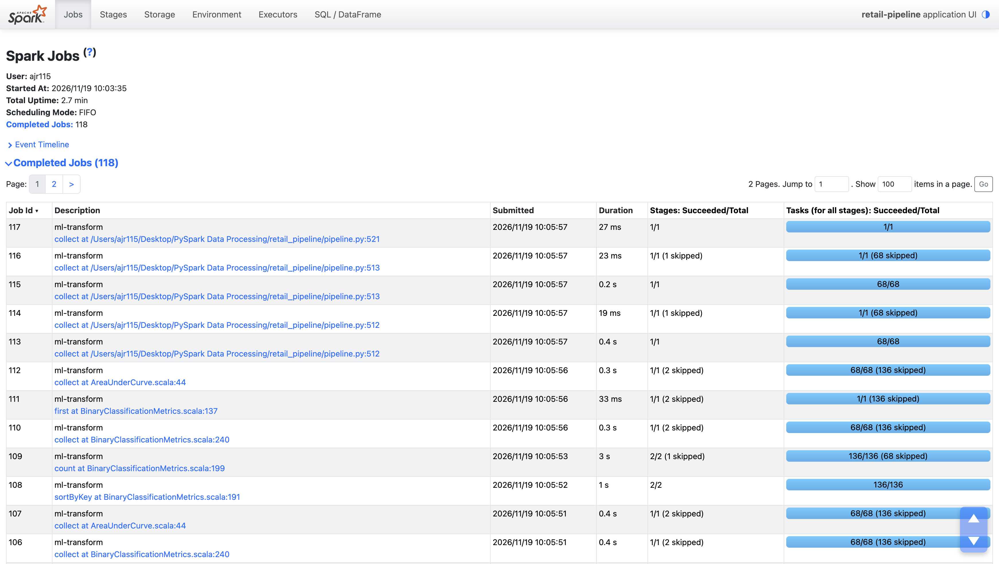
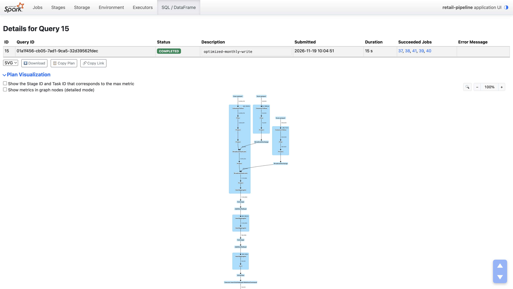
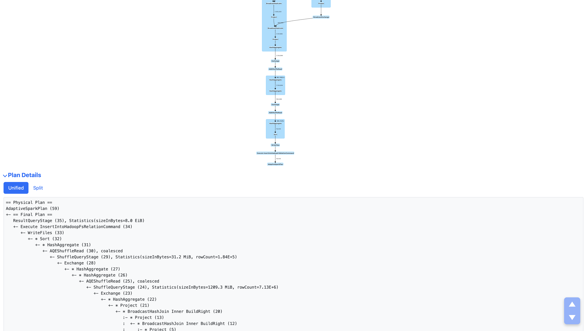

# Retail PySpark pipeline

A local Spark job over a generated retail star schema. It loads Parquet, filters, broadcasts two dimension tables, aggregates, runs Spark SQL, writes Parquet, compares a cached and an uncached action, and fits a logistic regression. The run below is Spark 4.3.0 in `local[*]` (8 threads) on Java 21.

This is one JVM using Spark's distributed scheduler. The physical plan still contains the exchanges a cluster would ship over the network. On this machine those exchanges were local: shuffle metrics report 0 remote bytes and 0 spill.

## Run it

```bash
./bootstrap.sh
.venv/bin/python pyspark_pipeline.py
```

`bootstrap.sh` creates `.venv`, installs `pyspark` and `numpy`, and checks for a JDK 17+. This project keeps a Temurin 21 JDK in `.tools/jdk` (gitignored). PyCharm's bundled runtime cannot start Spark 4.3, because it does not include `jdk.incubator.vector`.

Useful flags:

```bash
.venv/bin/python pyspark_pipeline.py --max-rows 200000   # logic check
.venv/bin/python pyspark_pipeline.py --hold-ui           # leave port 4040 up
.venv/bin/python pyspark_pipeline.py --force-generate    # rebuild the Parquet
```

Outputs land in `output/monthly_sales` (Parquet, partitioned by `sale_year`) and `reports/` (explain text, timings, CSV extracts). `pyspark_pipeline.html` and `pyspark_pipeline.ipynb` are the same run, rendered.

## Dataset

Three Parquet tables, generated deterministically with `xxhash64` so a rerun matches:

| Table | Rows | On disk | Notes |
| --- | ---: | ---: | --- |
| `data/transactions` | 14,244,500 | 1.185 GB (1.103 GiB) | Partitioned by `sale_month`, 2022-01 through 2024-12 |
| `data/customers` | 500,000 | 2.6 MB | Region, segment, loyalty, age band |
| `data/products` | 20,000 | 106 KB | Category, subcategory, brand, list price |
| **Total** |  | **1.187 GB** |  |

`receipt_token` and `payment_ref` are high-entropy strings. They exist so the fact table is large enough for a distributed scan, and the revenue query never reads them. Sale dates run from 2022-01-01 through 2024-12-30.

The generator plants three patterns, and the queries below are there to recover them:

- In-store purchases use the customer's home region. Web, app, and marketplace purchases use an independent fulfillment region.
- Cancellation is more likely for marketplace orders, discounts of 20% and 60%, and quantities of 4 or 5.
- About 2% of rows have a 60% discount. The revenue pipeline drops them.

Category, region, segment, and loyalty are assigned independently of price, so those breakdowns should be nearly flat. That is a property of the generator, not a retail finding.

## What the pipeline does

`retail_pipeline/pipeline.py` builds one enriched fact and several actions on it.

1. Keep `sale_month >= 2023-01`, `status = COMPLETED`, `discount_pct <= 0.5`, and `quantity > 0`.
2. `withColumn` adds `gross_revenue`, `net_revenue`, `sale_year`, and `price_band`.
3. Broadcast the active products and the active customers, then inner-join.
4. `groupBy` year, month, store region, category, subcategory, channel, and price band. Aggregations are order count, units, gross, net, average discount, and distinct customers.
5. Write that cube to `output/monthly_sales`, partitioned by `sale_year`.
6. Spark SQL: status by channel and region match (with a `BROADCAST` hint), top 2024 category-region pairs from the cube, and segment-by-loyalty averages.
7. Cache the per-customer rollup and time the same average before and after.
8. Logistic regression on a 1-in-40 sample, predicting cancellation.

A second monthly aggregation joins first and disables broadcast, so its plan is a sort-merge join. Both versions produce the same totals: 7,137,692 orders and $2,365,962,617.92 net revenue.

## Actions and transformations

Building the June 2024 filtered frame took **0.043 seconds** and did not schedule a job (the Spark UI job count stayed at 20). `explain()` also did not schedule a job. `count()` is the action: it scheduled jobs and returned **318,813** rows in **0.33 seconds**.

That count is only one month. The actions that actually move the fact table are the ones below: the optimized write (15.4s), the uncached customer rollup (7.5s), and the model fit (10.4s).

## Performance

Numbers are from `reports/metrics.json` and from the final plan of SQL execution 15 (`optimized-monthly-write`).

| Step | Seconds |
| --- | ---: |
| Build lazy transformations | 0.043 |
| `count()` on June 2024 | 0.330 |
| Count, `sale_month >= 2023-01` | 0.368 |
| Count, `sale_date >= 2023-01-01` | 0.533 |
| Native status filter, one month | 0.133 |
| Python UDF status filter, one month | 1.350 |
| Naive sort-merge monthly agg | 13.644 |
| Optimized monthly agg and Parquet write | 15.394 |
| SQL status by channel | 3.104 |
| SQL over the monthly cube | 0.286 |
| Customer average, uncached | 6.326 |
| Customer average, cached | 0.242 |
| Logistic regression fit | 10.371 |

Catalyst pushed the revenue predicates into the Parquet scan and turned the month predicate into a partition filter. The physical plan shows `PushedFilters` for `status = COMPLETED`, `discount_pct <= 0.5`, and `quantity > 0`, and `PartitionFilters: [sale_month >= 2023-01]`. The scan's `ReadSchema` drops `receipt_token`, `payment_ref`, `device_type`, `promo_code`, `payment_method`, and `store_id`. A partial hash aggregate runs before the shuffle and a final aggregate runs after it. `countDistinct(customer_id)` adds a second exchange. The executed plan is an `AdaptiveSparkPlan` with two `BroadcastHashJoin` nodes (`BuildRight`). Whole-stage codegen wraps the scan and the aggregate.

The month filter and the date filter return the same **9,495,016** rows. The month filter finished in 0.37s and did not open the 2022 directories. The date filter has an empty partition-filter list, pushes `sale_date >= 2023-01-01` instead, and took 0.53s because those 2022 files are still opened. A Python UDF on `status` clears `PushedFilters`, inserts `BatchEvalPython`, and reads the token columns; on one month that was 1.35s versus 0.13s. After the dimensions are broadcast, the expensive step is the aggregation shuffle: the final plan records a **1,289 MiB** exchange of the **7.13 million** surviving fact rows. The naive plan pushes the same filters and then sort-merge joins both dimensions. Wall clock was similar (13.6s versus 15.4s, and the 15.4s includes the Parquet write) because this `local[*]` run reported **0 remote shuffle bytes** and **0 spill**. The broadcast plan is the one that does not repeat that exchange for each join when the same job runs on a cluster.

Filters, the narrow projection, and explicit broadcasts are written in that order so the customer side of the monthly query scans only `customer_id` and `is_active`, and so a later UDF cannot quietly disable pushdown. The fact table is stored in `sale_month` directories, which is why the partition filter matches a path. The cache sits on the customer rollup, the result SQL reads again, rather than on the raw fact table. The uncached average reran the join and shuffle in **6.33s**. After `persist()`, the same average took **0.24s**, and the segment query starts at `InMemoryTableScan`.

## Machine learning

A logistic regression predicts `status = CANCELLED` from quantity, unit price, discount, channel, category, segment, and loyalty. The sample is every 40th transaction in the 2023–2024 window with status completed or cancelled: **206,633** rows, **12.3%** cancelled.

ROC AUC is **0.705**. The largest weights are `discount_pct` (1.40), marketplace (0.72), and `quantity` (0.17). Category and loyalty weights are about 0.01, which matches those columns being independent of the label. At the default 0.5 threshold the model predicts no cancellations: precision on the positive class is undefined and accuracy equals the **87.7%** majority-class baseline. The ranking is the useful output, not that threshold.

## Key findings

Completed in-window orders after the data-quality filters: **7,137,692**, net revenue **$2.37 billion**. Category-by-region revenue is flat. The leading cells are all about **$18.9 million** (Grocery in the Southeast, Automotive in the West, and so on). That is what independent category, region, and price assignments produce. It is not evidence that Grocery or the Southeast is special.

Cancellation and region match are the patterns in the data.

- Marketplace transactions are cancelled **21.8%** of the time (504,353 of 2,313,826). Web, app, and store are each about **7.8%**.
- Every in-store transaction is in the customer's home region. Web, app, and marketplace transactions are cross-region about **7/8** of the time (app cross-region share is 87.5%).
- Segment and loyalty do not separate spend. All 16 segment-loyalty cells are about **$4,850** lifetime net and **14.6** orders, across **487,499** active customers who had a qualifying purchase.

## Screenshots

Spark UI at `http://127.0.0.1:4040` after the run (`--hold-ui`). All 118 jobs succeeded.



Query 15 is `optimized-monthly-write` (15s, completed). The DAG shows `BroadcastExchange` and `BroadcastHashJoin` instead of a shuffle of the fact table.



The expanded physical plan is an `AdaptiveSparkPlan` with two broadcast hash joins and the aggregation exchanges above them.



Full `explain()` text is in `reports/explain_optimized.txt`, `reports/explain_naive.txt`, `reports/explain_pruning_month.txt`, `reports/explain_pruning_date.txt`, and `reports/explain_udf_blocked.txt`.

## Layout

```
pyspark_pipeline.py          entry point
retail_pipeline/generate.py  star-schema generator
retail_pipeline/pipeline.py  filters, joins, SQL, cache, model
retail_pipeline/session.py   SparkSession, explain, UI helpers
reports/                     plans, metrics, screenshots
output/monthly_sales         aggregated Parquet
data/                        generated Parquet (gitignored)
```
